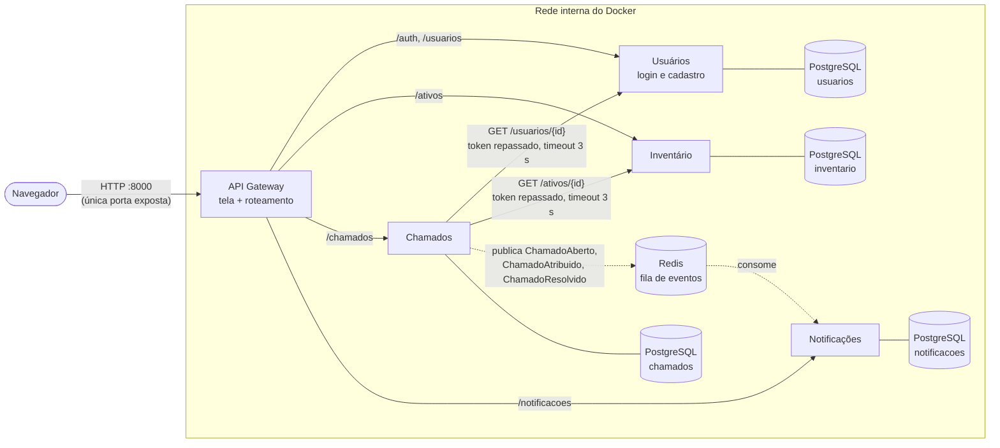

# HelpDesk TI · versão em microsserviços

> 🎥 **Vídeo de demonstração:** https://youtu.be/tdGbuqUKAzo

Sistema de chamados de TI (no estilo de um GLPI simplificado), feito em Python + FastAPI.
Começou como um monólito ([projeto base](https://github.com/prof-filipecavalcante/helpdesk-ti))
e foi separado em microsserviços para a atividade de Arquitetura de Software (veja [DESAFIO.md](DESAFIO.md)).


## Arquitetura



| Serviço | O que faz | Banco | Fala com |
|---|---|---|---|
| **gateway** | Serve a tela e encaminha cada rota para o serviço dono dela. `GET /saude` mostra quem está no ar. | nenhum | todos (HTTP) |
| **usuarios** | Cadastro de usuários e login (emite o token JWT). | `db-usuarios` | ninguém |
| **inventario** | Cadastro de equipamentos. | `db-inventario` | ninguém |
| **chamados** | Abre, atribui, muda status, comenta, painel e SLA. | `db-chamados` | usuarios e inventario (HTTP), Redis (eventos) |
| **notificacoes** | Lê os eventos da fila e grava os avisos de cada usuário. | `db-notificacoes` | Redis |

Linhas cheias são chamadas HTTP (síncronas). Linhas tracejadas são eventos (assíncronos).

### Estrutura

```
comum/                  # biblioteca técnica compartilhada: token JWT, cabeçalhos de segurança, erros
gateway/                # API Gateway (FastAPI + httpx) e a tela (web/)
servicos/
├── usuarios/           # cada serviço: Dockerfile, requirements.txt, app/ e tests/ próprios
├── inventario/
├── chamados/           # app/clientes.py (HTTP) e app/eventos.py (fila)
└── notificacoes/       # app/consumidor.py (lê a fila)
docker-compose.yml      # sobe tudo: gateway, 4 serviços, 4 bancos, Redis
```

## Como rodar

Precisa só do Docker.

```bash
docker compose up --build
```

Depois abra **http://localhost:8000**. Não é preciso criar `.env`: na primeira subida, o
contêiner `segredos` gera o segredo do JWT e a senha dos bancos em um volume do Docker.

Comandos úteis:

```bash
docker compose ps                      # todos os contêineres no ar
curl http://localhost:8000/saude       # quais serviços estão no ar
docker compose stop inventario         # simula a queda de um serviço
docker compose start inventario        # e traz de volta
docker compose logs -f notificacoes    # eventos chegando
docker volume ls | grep helpdesk       # um volume de dados por banco
docker compose down -v                 # apaga tudo (inclusive os dados)
```

### Contas de acesso

Criadas automaticamente com `DADOS_EXEMPLO=1` (padrão). Todas usam a senha `Helpdesk2026`.

| E-mail | Perfil |
|---|---|
| admin@empresa.com | Administrador |
| carla@empresa.com | Técnica (use esta para o fluxo completo) |
| diego@empresa.com | Técnico |
| ana@empresa.com | Solicitante (vê só os próprios chamados) |
| bruno@empresa.com | Solicitante |

Estas contas têm senha conhecida e servem só para aula. Em produção, use `DADOS_EXEMPLO=0`.

### Configuração

Opcional. Copie `.env.example` para `.env` para trocar o tempo do login, a senha das contas de
exemplo ou definir o seu próprio `JWT_SEGREDO`. O `.env` nunca vai para o GitHub.

## Rotas (pelo gateway, porta 8000)

Todas exigem login, exceto `/auth/login` e `/saude`.

| Método | Rota | Serviço | Quem pode |
|---|---|---|---|
| POST | `/auth/login` | usuarios | Todos |
| GET | `/auth/eu` | usuarios | Logado |
| POST / GET | `/usuarios` | usuarios | Admin / logado |
| GET | `/usuarios/{id}` | usuarios | Logado (usado por chamados) |
| POST / GET | `/ativos` | inventario | Técnico e admin / logado |
| GET | `/ativos/{id}` | inventario | Logado (usado por chamados) |
| POST / GET | `/chamados` | chamados | Logado (solicitante vê só os seus) |
| GET | `/chamados/painel` | chamados | Logado |
| PATCH | `/chamados/{id}/atribuir` | chamados | Técnico e admin |
| PATCH | `/chamados/{id}/status` | chamados | Técnico e admin (solicitante: fechar ou reabrir) |
| POST | `/chamados/{id}/comentarios` | chamados | Envolvidos |
| GET | `/notificacoes` | notificacoes | Logado (só as próprias) |
| GET | `/saude` | gateway | Todos |

## Decisões

**Login só no serviço de Usuários; cada serviço confere o token sozinho.**
O JWT é assinado com um segredo compartilhado (`JWT_SEGREDO`). Cada serviço valida assinatura,
emissor, validade e perfil sem chamar Usuários a cada requisição. Assim um serviço não depende
de Usuários estar no ar só para saber quem é o usuário. O lado ruim: um usuário desativado
continua com acesso até o token vencer (60 min). O gateway não confere o token, só encaminha.
Mesmo que alguém chegasse direto a um serviço, ainda precisaria de um token válido.

**Biblioteca `comum/` só com código técnico.**
Token, cabeçalhos de segurança e tratamento de erros ficam em um lugar só, para não copiar o
mesmo código de segurança cinco vezes. Ela não tem regra de negócio nem modelos de banco: cada
serviço continua dono dos seus dados. Cada imagem copia a sua cópia da `comum/` no build.

**Um PostgreSQL por serviço, sem chaves estrangeiras entre serviços.**
A tabela `chamados` guarda só `solicitante_id`, `tecnico_id` e `ativo_id`. A existência do
técnico e do equipamento é conferida por HTTP na hora de gravar. A chave estrangeira
`comentarios → chamados` continua, porque as duas tabelas são do mesmo serviço.

**Chamadas HTTP com timeout e 503.**
`servicos/chamados/app/clientes.py` faz `GET /usuarios/{id}` e `GET /ativos/{id}` com tempo
limite de 3 s e repassa o token do usuário. Se o outro serviço estiver fora do ar ou demorar,
a resposta é **503** com uma mensagem clara, e nada é gravado. Abrir chamado *sem* equipamento
não depende do Inventário e continua funcionando com ele fora do ar.

**Notificações por evento (Redis).**
Em vez de chamar Notificações, Chamados publica `ChamadoAberto`, `ChamadoAtribuido` e
`ChamadoResolvido` em uma lista do Redis (`LPUSH`). O serviço de Notificações consome com
`BRPOP` e grava os avisos. Se Notificações cair, os eventos esperam na fila e são lidos quando
ele voltar. Se o Redis cair, o chamado é salvo do mesmo jeito e só o aviso se perde (fica no
log). Para não perder nem isso, o próximo passo seria o padrão *outbox*.

**Gateway em FastAPI, não Nginx.**
Ele também serve a tela, mostra a saúde de todos os serviços em `/saude`, devolve 503 com
mensagem em português quando um serviço cai e só repassa os cabeçalhos necessários
(sobrescrevendo o `X-Forwarded-For` com o IP real).

**Segredos gerados na primeira subida.**
Para `docker compose up --build` funcionar sem ajuste manual e sem segredo no código, o
contêiner `segredos` cria o segredo do JWT e a senha dos bancos em um volume. Se o `.env`
definir `JWT_SEGREDO`, ele tem prioridade.

**Dados de exemplo com ids fixos.**
Cada serviço cria os seus dados de exemplo sozinho. Os chamados de exemplo usam os ids que os
outros serviços criam (Ana = 2, Bruno = 3, Carla = 4, equipamentos 1 e 2), para a subida não
depender da rede.

## O que melhorou e o que ficou mais difícil

| Melhorou | Ficou mais difícil |
|---|---|
| Cada serviço pode ser publicado, escalado e reiniciado sozinho. | Agora existe a rede no meio: latência, timeouts e falhas parciais. |
| A queda de um serviço não derruba o sistema todo (só as rotas dele respondem 503). | Não há mais transação única: atribuir faz uma chamada HTTP e depois grava. |
| Cada time é dono do seu código e do seu banco. | Sem chave estrangeira, a integridade entre serviços é conferida pela aplicação. |
| Notificações não atrasam nem derrubam a abertura de chamados. | Avisos são eventuais (chegam um instante depois) e podem se perder se o Redis cair. |
| Os testes de cada serviço rodam separados e mais rápido. | Mais peças para subir, monitorar e proteger (10 contêineres em vez de 1). |

## Testes

Cada serviço tem os seus testes, incluindo os de segurança (token falso, vencido, `alg: none`,
perfil inventado, permissões, campos extras, limites de tamanho). Os serviços vizinhos são
simulados com `httpx.MockTransport`, então o código de rede de verdade é testado, inclusive
quedas e timeouts.

```bash
cd servicos/chamados   # ou usuarios, inventario, notificacoes, gateway
pip install -r requirements.txt pytest httpx
pytest -q
```

No GitHub Actions, cada serviço roda em um job separado, com `pip-audit` nas dependências, e
há uma checagem de que só o gateway publica porta.

## Segurança

Veja [SECURITY.md](SECURITY.md).
